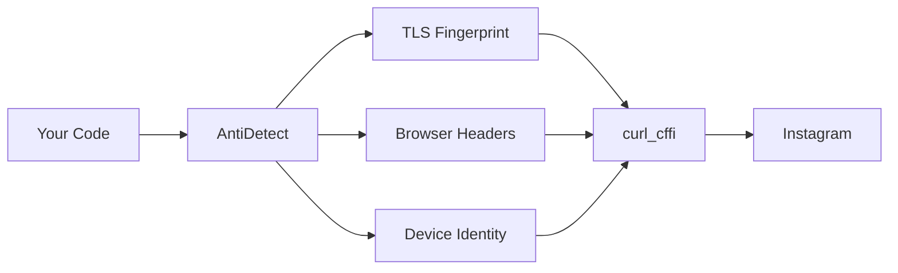

# Anti-Detection System

InstaHarvest v2 uses `curl_cffi` to impersonate real browsers at the TLS level — making requests indistinguishable from genuine browser traffic.

## How It Works



## TLS Fingerprint Rotation

For anonymous requests, `AntiDetect` rotates coherent Chrome TLS/header profiles across requests (for authenticated sessions, `SmartRotationCoordinator` locks identity to the session's browser fingerprint):

```python
# Automatic — no config needed
ig = Instagram.anonymous()
profile = ig.public.get_profile("nike")
# Rotates across coherent Chrome 142 / Chrome 136 profiles
# on Windows, macOS, and Linux
```

### Supported Browser Profiles

| Browser | Versions | Platforms |
|---|---|---|
| Chrome | 142 (`chrome142`), 136 (`chrome136`) | Windows, macOS, Linux |

## Header Randomization

Each request gets unique, browser-accurate headers:

| Header | Behavior |
|---|---|
| `User-Agent` | Matches TLS fingerprint browser |
| `Accept-Language` | Selected from configured locales |
| `Sec-Ch-Ua` | Matches browser version |
| `Sec-Fetch-*` | Correct for request type |
| `X-IG-App-ID` | Instagram web app ID |
| `X-IG-WWW-Claim` | Session claim token |

## Per-Request Identity

```python
# Example anonymous identities generated by AntiDetect:
# Identity 1:
#   TLS: chrome142
#   UA: Mozilla/5.0 (Macintosh; Intel Mac OS X 10_15_7) ... Chrome/142.0.0.0 Safari/537.36
#   Proxy: proxy1.com

# Identity 2:
#   TLS: chrome136
#   UA: Mozilla/5.0 (Windows NT 10.0; Win64; x64) ... Chrome/136.0.0.0 Safari/537.36
#   Proxy: proxy2.com
```

## Device Fingerprint

For mobile API requests, InstaHarvest v2 generates realistic deterministic Android device fingerprints:

```python
from instaharvest_v2.device_fingerprint import DeviceFingerprint

device = DeviceFingerprint.generate("my_account")
print(device.manufacturer)         # e.g. "Samsung"
print(device.model)                # e.g. "SM-S928B"
print(device.android_release)      # e.g. "15"
print(device.dpi)                  # e.g. "640dpi"
print(device.resolution)           # e.g. "1440x3120"
print(device.ig_app_version)       # e.g. "371.0.0.48.98"
print(device.ig_app_version_code)  # Android app build code
```

## 401/403 Auto-Retry

When Instagram returns 401 or 403:

1. **Rotate proxy** — switch to next working proxy
2. **New TLS fingerprint** — different browser identity
3. **New headers** — fresh User-Agent, Accept-Language
4. **Retry request** — with completely new identity

```python
# Automatic — no config needed
ig = Instagram.anonymous()
# If request fails with 401/403:
#   → Auto rotate proxy
#   → Auto change browser fingerprint
#   → Auto retry (up to 3 times)
```
